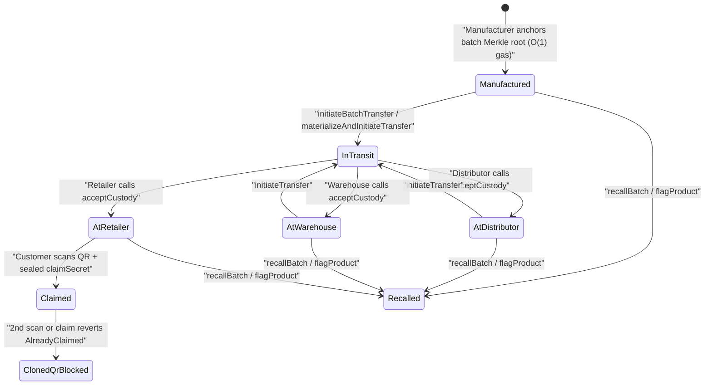
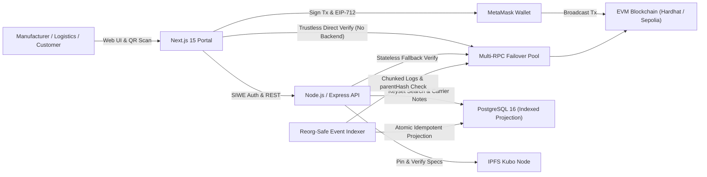
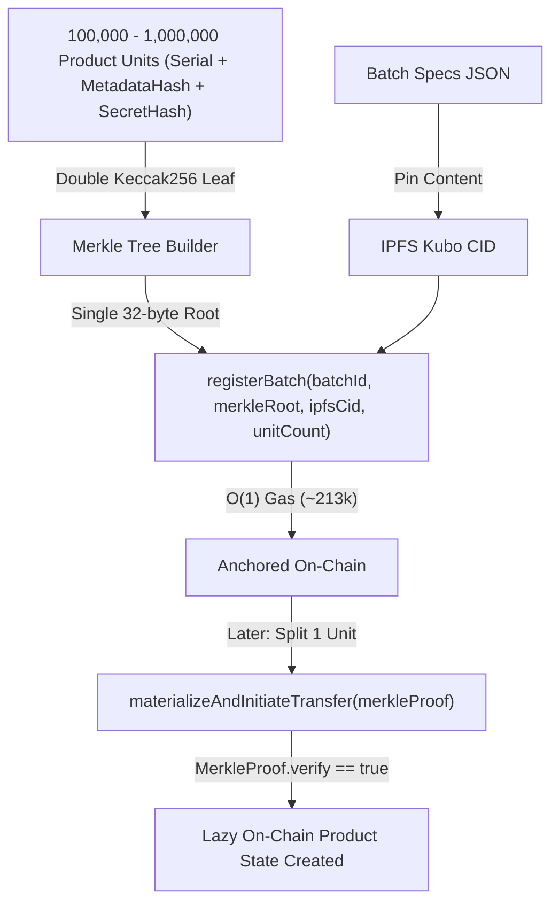
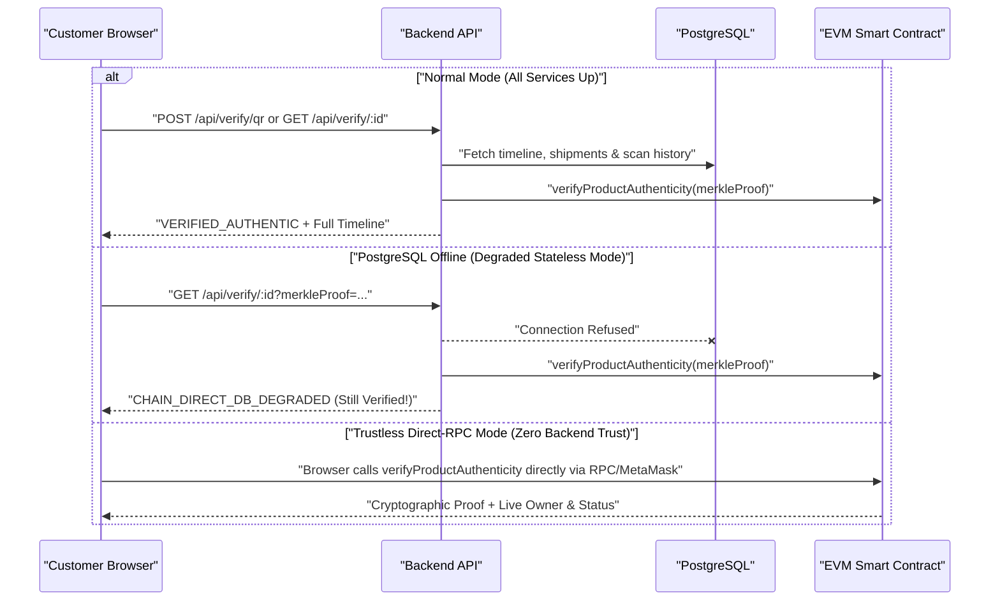
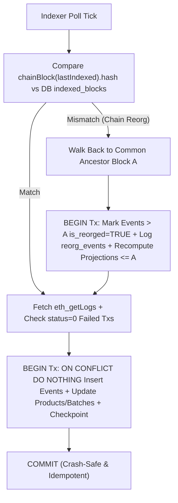

# ChainTrace Enterprise

**Decentralized Supply Chain Tracking & Product Authentication Platform**

ChainTrace Enterprise is a production-oriented Web3 supply-chain provenance and anti-counterfeit platform built to track physical goods from manufacturing through **Distributor → Warehouse → Retailer → Customer** with cryptographic verifiability, reorg-safe blockchain indexing, and sub-5 ms search across **1,000,000+ products**.

---

## Table of Contents

1. [Business Problem & Solution](#1-business-problem--solution)
2. [System Architecture & Source-of-Truth Model](#2-system-architecture--source-of-truth-model)
3. [Core Modules](#3-core-modules)
4. [Advanced Engineering & Failure Resilience](#4-advanced-engineering--failure-resilience)
5. [Technology Stack & Monorepo Layout](#5-technology-stack--monorepo-layout)
6. [Quickstart Guide (Local Development)](#6-quickstart-guide-local-development)
7. [Docker & Testnet Deployment](#7-docker--testnet-deployment)
8. [API Reference & Smart Contract Entrypoints](#8-api-reference--smart-contract-entrypoints)
9. [Verified Tests, Coverage & 1M-Scale Benchmarks](#9-verified-tests-coverage--1m-scale-benchmarks)
10. [Documentation Index](#10-documentation-index)

---

## 1. Business Problem & Solution

Traditional supply chains rely on isolated, mutable databases owned by individual companies. That creates four structural vulnerabilities:
- A distributor or warehouse can alter delivery records retroactively.
- A retailer can mix counterfeit inventory into legitimate shipments.
- Manufacturers lack end-to-end cryptographic visibility across multi-hop custody transfers.
- Customers cannot independently verify product authenticity without trusting a centralized vendor server.

**ChainTrace Enterprise solves this by anchoring ownership and product commitments on an EVM blockchain (`ChainTraceRegistry.sol`) while treating PostgreSQL strictly as a fast, rebuildable search projection.**

### Supply Chain Lifecycle at a Glance



---

## 2. System Architecture & Source-of-Truth Model



### What Lives Where (And Why)

| Layer | Technology | Data Stored | Source of Truth? |
| :--- | :--- | :--- | :--- |
| **Smart Contracts** | Solidity `0.8.28`, OpenZeppelin v5 | Role permissions (`AccessControl`), O(1)-gas batch Merkle roots, lazy-materialized product custody, monotonic `nonce`, EIP-712 intents, sealed claim states, recalls | **Yes (Authoritative Ownership)** |
| **Decentralized Storage** | IPFS Kubo (`v0.32.1`) | Canonical JSON product specs & batch metadata verified against on-chain `metadataHash` | **Yes (Content Integrity)** |
| **Event Indexer** | Node.js, TypeScript, Ethers v6 | Adaptive log backfill, `block_hash` / `parentHash` continuity, atomic reorg rollbacks, decoded reverted transactions | Sync Worker |
| **Backend API** | Express, TypeScript, SIWE, Zod | SIWE challenge-response auth, Merkle batch prep & IPFS pinning, cursor-paginated search, RPC circuit-breaker pool, stateless DB-offline fallback, OpenAPI docs | Orchestration & Cache |
| **Relational DB** | PostgreSQL 16 | Fast search across 1M+ products (`text_pattern_ops`, `pg_trgm`), off-chain carrier tracking notes, QR scan anomaly logs | **No (Rebuildable Projection)** |
| **Frontend** | Next.js 15, React 19, Tailwind | Manufacturer, Logistics, Explorer, and Customer Verification UIs + Direct-RPC browser verification | Presentation & Wallet Signing |

---

## 3. Core Modules

### Module 1: Manufacturer Dashboard (`/manufacturer`)
- Create product batches (`1` to `100,000` units) with deterministic `batchId` and `productId` derivation.
- Automatically canonicalize metadata JSON, pin to IPFS Kubo, generate Keccak256 Merkle tree + sealed one-time `claimSecret` per unit, and anchor `merkleRoot` on-chain in a single `registerBatch` transaction (`O(1)` gas).
- Inspect batch units, generate downloadable QR PNG labels + JSON proofs, and issue on-chain `recallBatch` actions.

### Module 2: Logistics & Partner Custody Workbench (`/logistics`)
- Role-adaptive dashboard for **Distributors**, **Warehouses**, and **Retailers**.
- View incoming pending custody transfers (`acceptBatchCustody` / `acceptCustody`).
- Transfer whole pallets (`initiateBatchTransfer`) or split individual units out of a batch on demand (`materializeAndInitiateTransfer`).
- Update delivery milestones (`updateDeliveryStatus` / `updateBatchDeliveryStatus`) and attach off-chain carrier/tracking/temperature records keyed by `txHash`.

### Module 3: Smart Contract System (`ChainTraceRegistry.sol`)
- Role-based access control (`MANUFACTURER_ROLE`, `DISTRIBUTOR_ROLE`, `WAREHOUSE_ROLE`, `RETAILER_ROLE`, `AUDITOR_ROLE`, `DEFAULT_ADMIN_ROLE`).
- Two-step custody transfers (`initiateTransfer` → `acceptCustody` + `cancelTransfer`) so recipients cannot be forced to accept unauthorized inventory.
- Per-product monotonic `uint64 nonce` (`StaleNonce`) and `pendingCustodian` locking (`TransferAlreadyPending`).
- EIP-712 typed-signature meta-transactions (`executeTransferBySig`, `claimProductBySig`) with `deadline` and `nonce` replay protection.
- Double-hashed Merkle leaf verification (`keccak256(bytes.concat(keccak256(abi.encode(...))))`) immune to second-preimage attacks.

#### How 1,000,000 Products Anchor in 1 Blockchain Transaction



### Module 4: Blockchain Explorer & Anomaly Monitor (`/explorer`)
- Live chain tip, indexer lag, canonical/reorged event stream, and RPC pool circuit-breaker status.
- Interactive transaction hash verifier querying live on-chain receipts, decoded logs, and indexed records.
- **Security & Anomaly Monitor**:
  - Decodes reverted unauthorized calls mined on-chain (`AccessControlUnauthorizedAccount`, `UnauthorizedCustodian`, `StaleNonce`, `InvalidMerkleProof`).
  - Displays chain reorganization rollbacks (`reorg_events`).
  - Surfaces suspicious duplicate/high-velocity QR scan alerts (`scan_logs`).
  - Executes a live **DB-vs-Chain Integrity Diff** comparing PostgreSQL state against `ChainTraceRegistry.getBatch` to expose silent database tampering.

### Module 5: Customer Verification Portal (`/verify`)
- Three verification input methods: **Live Camera QR Scanner**, **Upload QR Image**, and **Serial / Product ID / JSON Paste**.
- **Trustless Direct-RPC Mode**: Toggle that verifies Merkle inclusion and live contract state directly from the browser via RPC/MetaMask without trusting or calling the backend API.
- Displays full supply-chain provenance timeline, manufacturing specs, recall/tamper warnings, and **One-Time Sealed Claim** activation (`claimProduct`) to permanently block cloned QR stickers.

#### Dual-Mode Verification (Even If Backend or DB Fails)



---

## 4. Advanced Engineering & Failure Resilience

| Failure / Scale Scenario | How ChainTrace Handles It |
| :--- | :--- |
| **1,000,000+ Products & Gas Limits** | `registerBatch` stores only a `bytes32 merkleRoot` + `ipfsCid` (`O(1)` gas). Individual units materialize lazily on first split. PostgreSQL uses `text_pattern_ops`, `pg_trgm`, and keyset cursor pagination (zero `OFFSET`). |
| **Simultaneous Conflicting Transfers** | On-chain `pendingCustodian` lock + monotonic `expectedNonce` deterministically revert concurrent races (`TransferAlreadyPending` / `StaleNonce`). |
| **Blockchain Reorganization (Reorg)** | `ReorgSafeIndexer` stores `(block_number, block_hash, parent_hash)`. On hash mismatch, it walks back to the common ancestor, marks orphaned events `is_reorged = TRUE`, logs `reorg_events`, and atomically recomputes affected projections. |
| **Primary RPC Provider Goes Offline** | `RpcFailoverPool` trips the circuit breaker on transport/timeout failures (while passing through Solidity `CALL_EXCEPTION` reverts cleanly) and fails over to secondary RPCs. If all RPCs are down, `/api/verify` serves `RPC_UNAVAILABLE_CACHED` with an explicit warning. |
| **PostgreSQL Becomes Unavailable** | `GET /api/verify/:identifier` catches DB errors and falls back to **Stateless Direct-RPC Mode** (`CHAIN_DIRECT_DB_DEGRADED`) using the QR Merkle proof against `ChainTraceRegistry.verifyProductAuthenticity`. |
| **Indexer Crash & Restart** | Events, block headers, projections, and `indexer_checkpoints` commit in a single PostgreSQL transaction with `UNIQUE (chain_id, block_hash, tx_hash, log_index)` idempotency (`ON CONFLICT DO NOTHING`). |
| **10,000 Concurrent Write/Read Calls** | Reads scale via indexed Postgres + RPC pool; optional gasless claims route through `RelayerQueueService` with Postgres `idempotency_key` deduplication and serialized nonce signing. |

### How Reorg Rollback & Crash Recovery Work



---

## 5. Technology Stack & Monorepo Layout

```text
blockchain/
├── packages/
│   ├── contracts/          # Solidity 0.8.28, Hardhat, TypeChain, deploy & gas/coverage tests
│   └── shared/             # Canonical Keccak256 Merkle SDK, Zod schemas, ABI, RpcFailoverPool, IpfsClient
├── apps/
│   ├── indexer/            # Reorg-safe event & failed-tx indexer + Hardhat/Postgres integration test
│   ├── api/                # Express TypeScript API, SIWE auth, migrations, Swagger /api/docs, integration tests
│   └── web/                # Next.js 15 App Router UI (5 modules + Direct-RPC verification)
├── infra/docker/           # Service & Web Dockerfiles
├── scripts/                # demo_lifecycle.ts (5-party E2E) & benchmark_scale.ts (1M rows / 10k reqs)
├── docs/                   # Architecture, ER schema, audit, test, performance & interview Q&A reports
├── .github/workflows/      # GitHub Actions CI pipeline
└── docker-compose.yml      # PostgreSQL 16, IPFS Kubo, and optional full-stack containers
```

---

## 6. Quickstart Guide (Local Development)

### Prerequisites
- **Node.js `>= 20`** (verified on `v24.18.0`) & **npm `>= 10`**
- **Docker & Docker Compose** (with Docker Desktop running)
- **MetaMask** browser extension (for interactive UI signing)

### Step-by-Step Setup

1. **Configure environment and install workspace dependencies:**
   ```bash
   cp .env.example .env
   npm install
   ```

2. **Start PostgreSQL 16 and IPFS Kubo containers:**
   ```bash
   npm run docker:infra
   ```

3. **Start a local Hardhat EVM node (Terminal 1):**
   ```bash
   npm run chain:node
   ```

4. **Deploy contracts & apply database migrations (Terminal 2):**
   ```bash
   npm run contracts:deploy:local
   npm run db:migrate
   ```
   > On `chainId 31337`, [deploy.ts](file:///c:/Users/zeelp/OneDrive/Desktop/blockchain/packages/contracts/scripts/deploy.ts) automatically grants on-chain roles to the default Hardhat test accounts:
   > - **Admin / Auditor:** Account `#0` (`0xf39Fd6e51aad88F6F4ce6aB8827279cffFb92266`)
   > - **Manufacturer:** Account `#1` (`0x70997970C51812dc3A010C7d01b50e0d17dc79C8`)
   > - **Distributor:** Account `#2` (`0x3C44CdDdB6a900fa2b585dd299e03d12FA4293BC`)
   > - **Warehouse:** Account `#3` (`0x90F79bf6EB2c4f870365E785982E1f101E93b906`)
   > - **Retailer:** Account `#4` (`0x15d34AAf54267DB7D7c367839AAf71A00a2C6A65`)

5. **Run Event Indexer, Backend API, and Next.js Frontend (separate terminals):**
   ```bash
   npm run dev:indexer
   npm run dev:api
   npm run dev:web
   ```

6. **Open the application:**
   - Web Portal: `http://localhost:3000`
   - Backend Health: `http://localhost:4000/health/ready`
   - Swagger API Docs: `http://localhost:4000/api/docs`

---

## 7. Docker & Testnet Deployment

### Full Containerized Stack
```bash
docker compose --profile full up --build -d
```

### Live EVM Testnet (e.g., Ethereum Sepolia)
1. Set `SEPOLIA_RPC_URL` and `DEPLOYER_PRIVATE_KEY` in `.env`.
2. Deploy:
   ```bash
   npm run deploy:sepolia --workspace=@chaintrace/contracts
   ```
3. Update `CONTRACT_ADDRESS`, `NEXT_PUBLIC_CONTRACT_ADDRESS`, `CHAIN_ID=11155111`, and `NEXT_PUBLIC_CHAIN_ID=11155111` in `.env`.

---

## 8. API Reference & Smart Contract Entrypoints

| Endpoint | Auth | Purpose |
| :--- | :--- | :--- |
| `GET /health/live`, `GET /health/ready` | Public | Liveness & dependency readiness (`postgres`, `ipfs`, `rpc`) |
| `POST /api/auth/nonce`, `POST /api/auth/verify` | Public | Single-use SIWE (`EIP-4361`) challenge-response login |
| `POST /api/batches/prepare` | Manufacturer | Pin metadata to IPFS, build Merkle tree + sealed secrets |
| `GET /api/batches`, `GET /api/batches/:batchId` | Public | Cursor-paginated batch & unit inspection |
| `GET /api/batches/:batchId/products/:id/qr` | Manufacturer | Generate QR PNG + payload with sealed `claimSecret` |
| `GET /api/products`, `GET /api/products/:id` | Public | Prefix/trigram search, Merkle proof & provenance lookup |
| `POST /api/products/shipments` | Partner Roles | Attach carrier tracking/temperature notes keyed by `txHash` |
| `GET /api/explorer/overview`, `/events`, `/tx/:hash`, `/anomalies` | Public | Chain telemetry, tx verification, reverted calls, reorgs & DB tamper diff |
| `GET /api/verify/:id`, `POST /api/verify/qr` | Public | Product verification with `CHAIN_DIRECT_DB_DEGRADED` fallback |
| `POST /api/relayer/claim` | Public | Optional idempotent EIP-712 gasless customer claim |

Full interactive OpenAPI 3.0 documentation is served at `/api/docs`.

---

## 9. Verified Tests, Coverage & 1M-Scale Benchmarks

Run all verification suites:

```bash
npm run typecheck
npm run build
npm run test --workspace=@chaintrace/shared
npm run test:gas --workspace=@chaintrace/contracts
npm run contracts:coverage
npm run test --workspace=@chaintrace/indexer -- --runInBand
npm run test --workspace=@chaintrace/api -- --runInBand
npx tsx scripts/demo_lifecycle.ts
npx tsx scripts/benchmark_scale.ts
```

### Observed Results
- **Typecheck & Build:** Passed across all 5 workspaces (`@chaintrace/shared`, `@chaintrace/contracts`, `@chaintrace/indexer`, `@chaintrace/api`, `@chaintrace/web`).
- **Shared SDK Tests:** 2 suites, 6 tests passed.
- **Smart Contract Tests:** 9/9 passed; Solidity coverage: **95.83% statements**, **100% functions**, **89.96% lines**.
- **Indexer Integration Test:** Passed against real Hardhat EVM + PostgreSQL (canonical indexing, reverted unauthorized tx decoding, crash/restart idempotency, and `evm_snapshot`/`evm_revert` reorg rollback).
- **API Integration Test:** Passed against real Hardhat EVM + PostgreSQL + IPFS Kubo (SIWE auth + replay guard, RBAC 403, IPFS pinning, DB tamper detection, DB-offline stateless fallback, RPC-offline degraded cache).
- **5-Party E2E Lifecycle Demo:** Passed (`verdict: 'CLAIMED_AUTHENTIC'`, 9 lifecycle events synced).
- **1M-Product & 10k-Concurrency Benchmark:**
  - 100,000-leaf Merkle tree generation: `28,084.93 ms`
  - 1,000,000-row PostgreSQL exact serial lookup: `5.07 ms` | cursor pagination: `2.72 ms`
  - 10,000 concurrent HTTP requests (window 200) against 1M rows: `10,000` succeeded, `0` failed, **`1,321.89 req/s`**, `p50: 107.85 ms`, `p95: 176.47 ms`, `p99: 421.94 ms`.

---

## 10. Documentation Index

- [System Architecture](file:///c:/Users/zeelp/OneDrive/Desktop/blockchain/docs/architecture.md)
- [Database Schema & Indexing](file:///c:/Users/zeelp/OneDrive/Desktop/blockchain/docs/database-schema.md)
- [Smart Contract Test & Coverage Report](file:///c:/Users/zeelp/OneDrive/Desktop/blockchain/docs/smart-contract-test-report.md)
- [Smart Contract & Platform Security Audit](file:///c:/Users/zeelp/OneDrive/Desktop/blockchain/docs/smart-contract-security-audit.md)
- [Performance & 1M-Scale Report](file:///c:/Users/zeelp/OneDrive/Desktop/blockchain/docs/performance-report.md)
- [Interview Architectural Defense (Q1–Q5)](file:///c:/Users/zeelp/OneDrive/Desktop/blockchain/docs/interview-qa.md)
- [GitHub Actions CI Workflow](file:///c:/Users/zeelp/OneDrive/Desktop/blockchain/.github/workflows/ci.yml)
