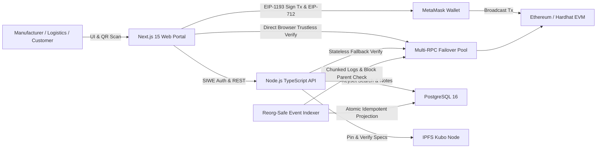
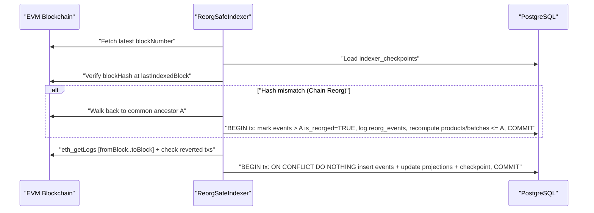

# ChainTrace Enterprise — System Architecture

## 1. Architectural Philosophy: What Lives Where and Why

The fundamental design invariant of ChainTrace Enterprise is that **PostgreSQL is never treated as the source of truth for ownership**. All databases can be wiped or tampered with, and every product's authenticity and current custody remain independently verifiable from the EVM blockchain and IPFS.

| Layer | Technology | Responsibilities | Source of Truth? |
| :--- | :--- | :--- | :--- |
| **Smart Contracts** | Solidity `0.8.28`, OpenZeppelin v5 | Role permissions (`AccessControl`), O(1)-gas batch Merkle roots, lazy product materialization, 2-step custody transfers, monotonic `nonce`, EIP-712 meta-txs, sealed customer claim, recalls | **Yes (Authoritative Ownership & State)** |
| **Decentralized Storage** | IPFS Kubo (`v0.32.1`) | Content-addressed manufacturing specs & batch metadata JSON verified against on-chain `metadataHash` | **Yes (Content Integrity via CID & Keccak256)** |
| **Event Indexer** | Node.js, TypeScript, Ethers v6 | Adaptive chunked log ingestion, `parentHash` continuity checks, atomic chain-reorg rollback, reverted unauthorized tx decoder | Projection Sync Worker |
| **Backend API** | Express, TypeScript, SIWE, Zod | SIWE challenge-response auth, Merkle batch prep & IPFS pinning, cursor-paginated queries, RPC failover + circuit breaker, stateless DB-offline verify fallback, Swagger/OpenAPI | Orchestration & Cache Layer |
| **Relational DB** | PostgreSQL 16 | Fast search over 1M+ products (`pg_trgm`, B-tree, keyset cursors), off-chain logistics tracking notes (`offchain_shipments`), duplicate scan telemetry (`scan_logs`) | **No (Rebuildable Projection)** |
| **Frontend Portal** | Next.js 15 App Router, React 19, Tailwind | Manufacturer Dashboard, Role-adaptive Logistics Workbench, Blockchain Explorer & Anomaly Monitor, Customer QR Portal + **Trustless Direct-RPC Mode** | Presentation & Wallet Signing |

---

## 2. System Topology

---

## 3. Reorg-Safe Indexing & Crash Recovery Sequence

---

## 4. Resilience Under Failure Scenarios

1. **Primary RPC Goes Offline:** `RpcFailoverPool` opens the circuit breaker for the failed endpoint after consecutive failures and routes requests to healthy secondary endpoints. If all RPCs fail, public verification falls back to `RPC_UNAVAILABLE_CACHED` mode with an explicit stale-data warning rather than crashing.
2. **Simultaneous Conflicting Transfers:** On-chain monotonic `uint64 nonce` (`expectedNonce`) and `pendingCustodian` lock guarantee that the second concurrent transfer reverts deterministically (`TransferAlreadyPending` or `StaleNonce`).
3. **Invalid / Unauthorized Contract Call:** Enforced by `AccessControl` + `custodian == msg.sender` + `MerkleProof.verify`. Reverted txs mined on-chain are captured by `ReorgSafeIndexer` into `failed_transactions` with decoded custom error names for the Blockchain Explorer.
4. **PostgreSQL Becomes Unavailable:** `GET /api/verify/:identifier` catches DB unavailability and switches seamlessly to **Stateless Direct-RPC Mode** (`CHAIN_DIRECT_DB_DEGRADED`) using the QR payload's Merkle proof against `ChainTraceRegistry.verifyProductAuthenticity(...)`, while the frontend also offers a **Direct Browser RPC Toggle**.
5. **Event Indexer Crash & Restart:** `indexer_checkpoints`, `indexed_blocks`, `product_events`, and `products`/`batches` projections commit inside a single PostgreSQL `BEGIN ... COMMIT` transaction with `UNIQUE (chain_id, block_hash, tx_hash, log_index)` idempotency (`ON CONFLICT DO NOTHING`), preventing missed or duplicated events across restarts.
