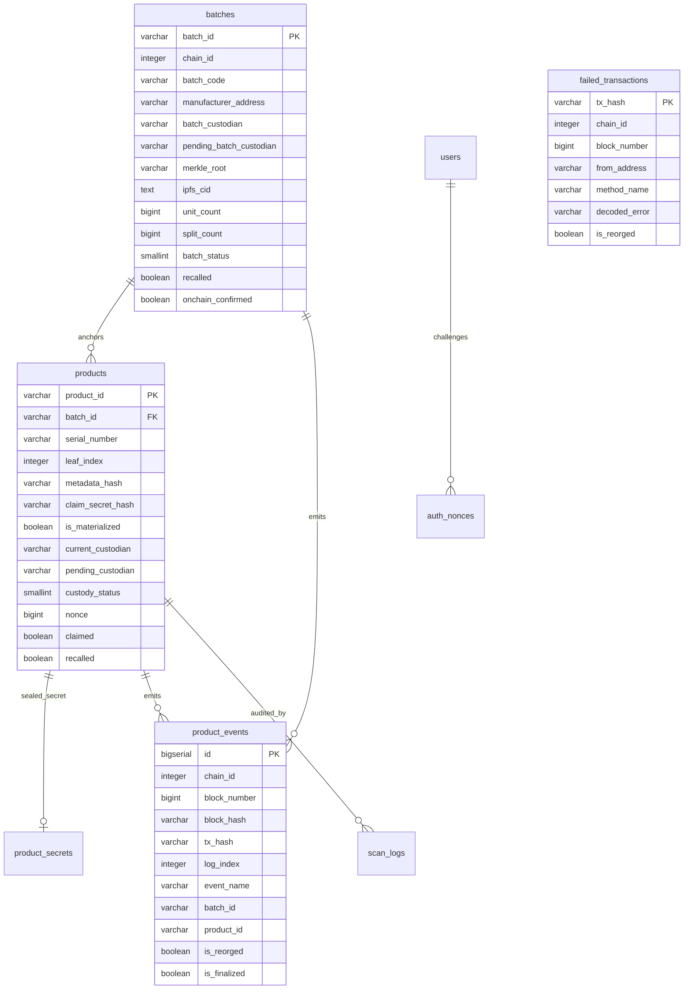

# ChainTrace Enterprise — Database Schema & Indexing Design

Database migrations live in [001_init.sql](file:///c:/Users/zeelp/OneDrive/Desktop/blockchain/apps/api/src/db/migrations/001_init.sql) and [002_perf_indexes.sql](file:///c:/Users/zeelp/OneDrive/Desktop/blockchain/apps/api/src/db/migrations/002_perf_indexes.sql).

## 1. Entity Relationship Diagram

## 2. Indexing Strategy for 1,000,000+ Products

- **Zero `OFFSET` Pagination:** All list endpoints (`GET /api/batches`, `GET /api/products`, `GET /api/explorer/events`) use deterministic **keyset cursor pagination** backed by `idx_products_cursor` (`created_at DESC, product_id DESC`) and primary key order (`ORDER BY product_id DESC`).
- **Exact & Substring Serial Lookup:**
  - `idx_products_serial_exact` (`B-tree` on `serial_number`) serves exact serial verification in sub-millisecond time.
  - `idx_products_serial_trgm` (`GIN` with `pg_trgm`) accelerates partial serial searches.
  - `idx_products_id_pattern` (`text_pattern_ops`) accelerates `0x...` prefix searches without sequential scans.
- **Partial Custody Indexes:** `idx_products_pending_custodian` indexes only rows where `pending_custodian IS NOT NULL`, keeping Partner Incoming Custody queues tiny even with 1M+ rows.
- **Idempotency & Reorg Continuity:** `product_events` enforces `UNIQUE (chain_id, block_hash, tx_hash, log_index)`, and `indexed_blocks` stores `(chain_id, block_number) -> (block_hash, parent_hash)` so reorgs are detected and rolled back atomically.
